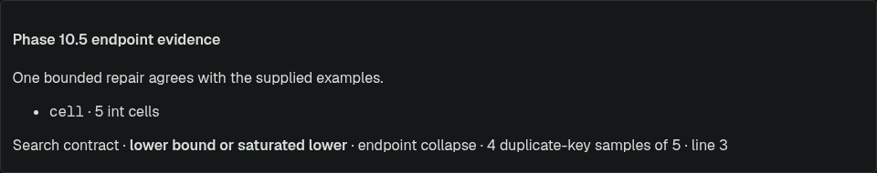
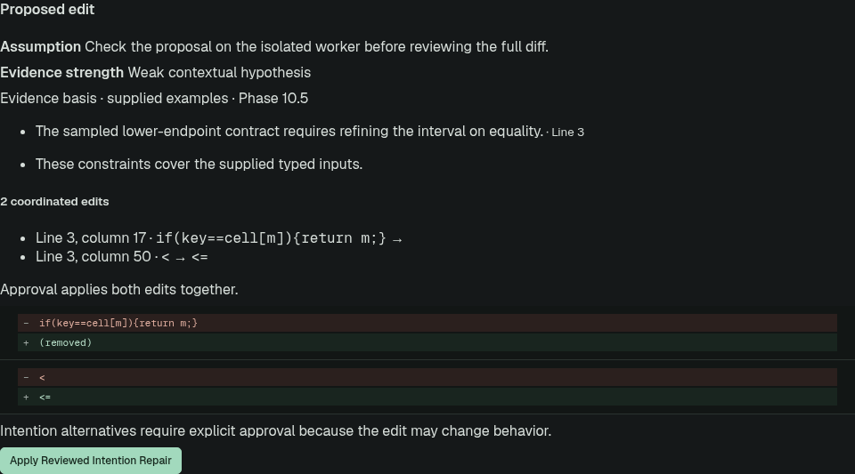
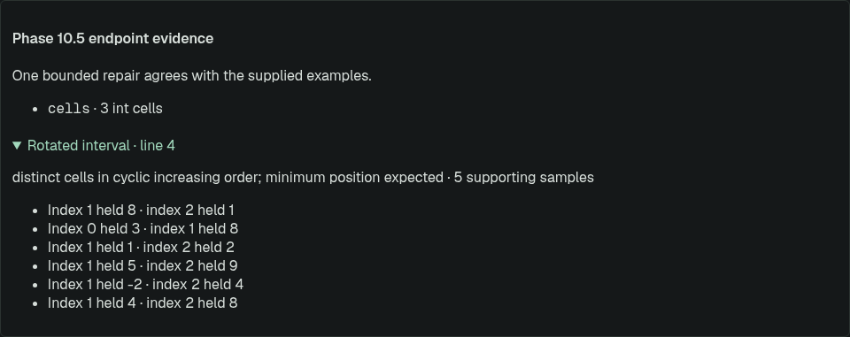
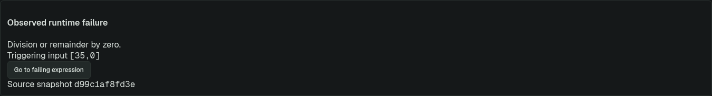

# Workbench

Choose **Phase 10.5 endpoint repair** for typed examples in the Intention panel or with candidate comparison in Interactive Behavioral Verification. The workbench shows compatible endpoint contracts and duplicate counts, checked array extents, neighboring indexes and values, rotation assumptions, zero guards, traversal origins and helper dependencies. Candidate review displays every edited span, compiler validity and supporting evidence.

The browser suite exercises two-site atomic approval, profile-based invalidation, and clearing a candidate preview when trusted vectors change. The original remains editable and the runtime panel keeps failure evidence distinct from a confirmed mismatch.

