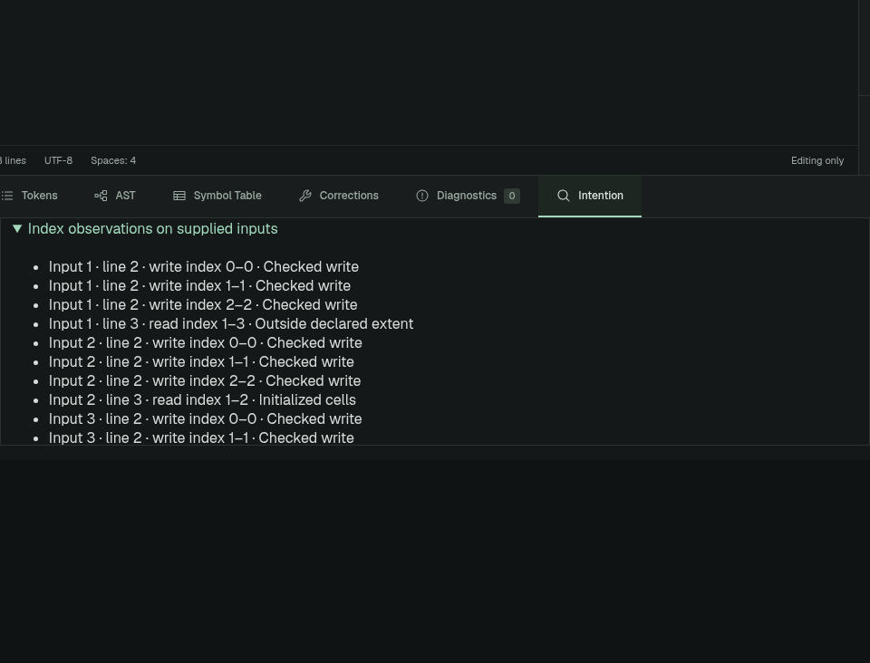
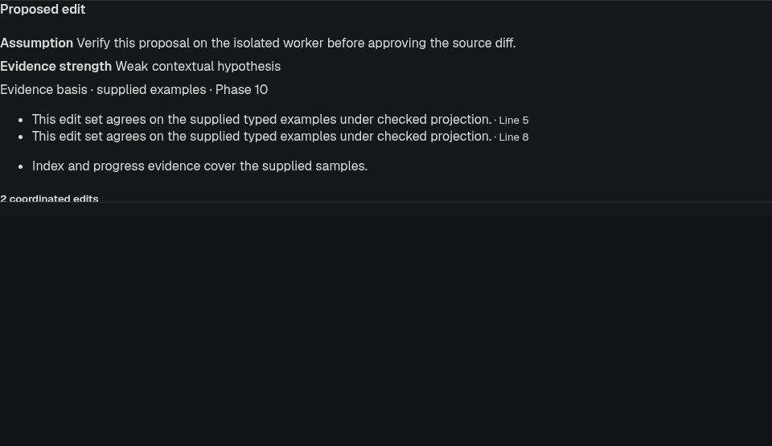
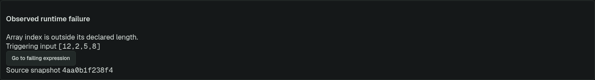

# Workbench evidence

Select **Phase 10 search repair** in Intention with typed examples. The panel shows array extents, sampled accesses, recursive interval frames, traversal origins and growth or remainder progress. The candidate view shows source spans, compiler validity, supporting and counter-evidence, and all edits together. Interactive behavioral verification shows the original worker outcome, candidate results and mismatches separately.

The Chromium scenarios exercise an invalid recursive access, manual atomic approval of two expansion edits, and clearing a stale isolated candidate preview after verification vectors change. A profile change clears stale intention evidence.

