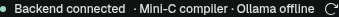
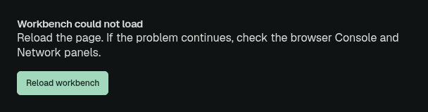
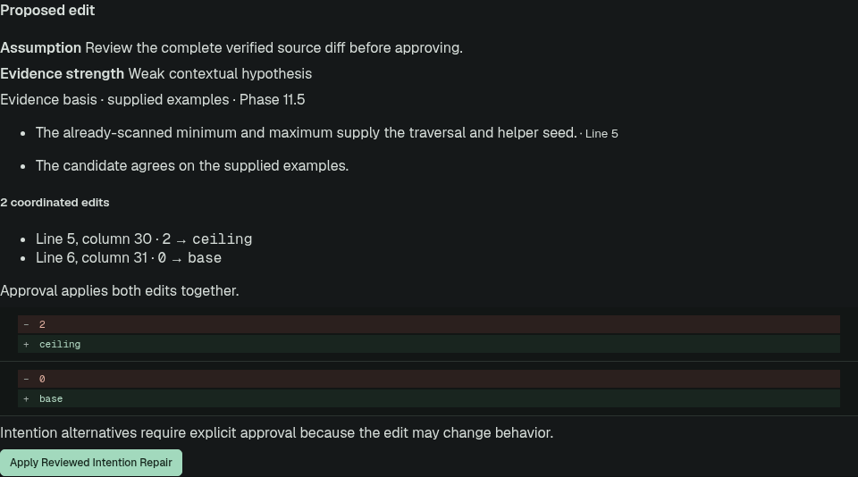

# Workbench behavior

The toolbar shows backend and compiler reachability. Interactive verification separately reports the worker state. Static HTML gives guidance when the entry script fails. A React error boundary provides a reload action if the application or its lazy module fails.

Select **Phase 11.5 repair reliability** for explicit endpoint, first-minimum and range facts. Both discovery-compatible interpolation candidates stay available after observed probes. The range preview contains both edits and applies only after explicit approval against the current source.

