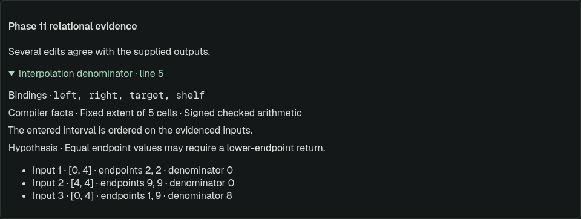
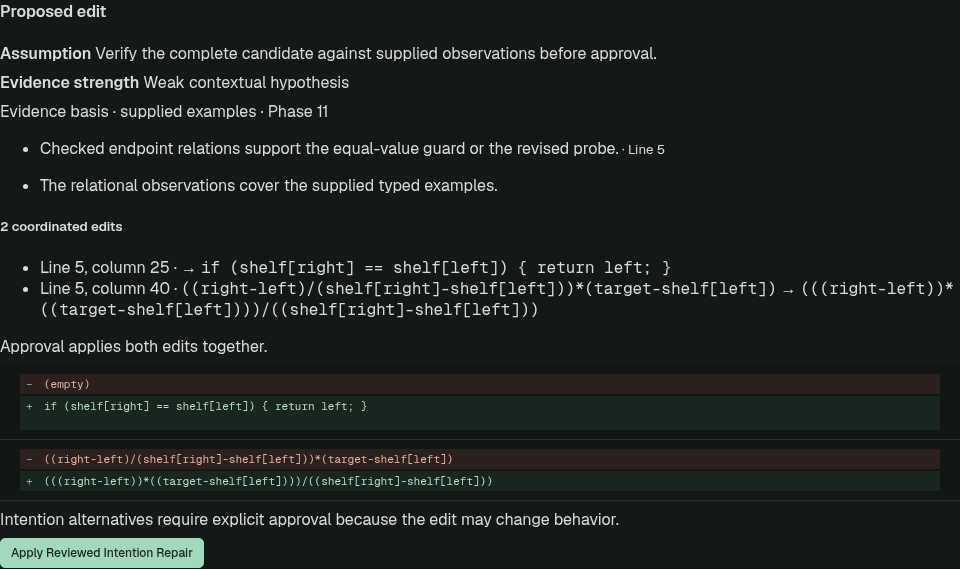
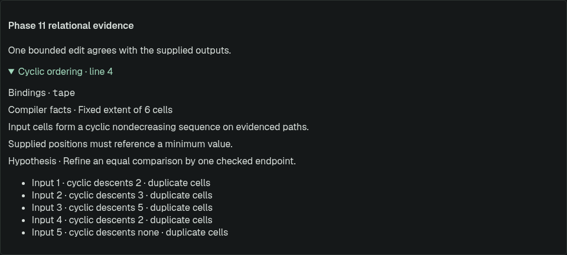
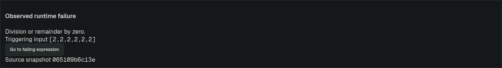

# Workbench

Select **Phase 11 relational repair** for typed examples in Intention or candidate comparison in Interactive Behavioral Verification. The new section shows endpoint values and the interpolation denominator, the cyclic ordering observations, helper inputs, range dependencies and the relevant source locations. Samples, assumptions and intended-behavior hypotheses are labeled. The parent candidate review shows compiler status, source edits, supporting and counter evidence and the apply action.

The Chromium scenarios capture joint two-site approval, cyclic evidence after checking duplicate cells, and invalidation when the profile or supplied worker vectors change.

