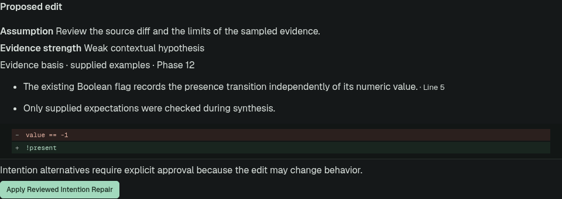

# Run a five-minute technical demo

1. Follow **Run locally** in the README. For interactive evidence, start the restricted worker before starting FastAPI and launch FastAPI in that environment. Open the workbench and choose **Explore demo examples**. [Setup](../README.md#run-locally) · [Worker setup](phase4_5_execution_isolation.md)
2. Load **Correct program**, choose **Analyze**, and inspect the tokens, AST and symbols. Load **Compiler diagnostic**, analyze again, and select the syntax diagnostic to locate the missing semicolon.
3. Load **Sentinel collision and manual repair**. The program returns 12 for a present input of −1. Expand **Demo expectations**, open **Intention**, select Phase 13 and the supplied-example mode, enter function `demo`, and paste the intention examples. Analyze and review the sentinel proposal. Its change uses the existing presence flag so −1 can remain a legitimate value.
4. With the private worker available, open **Interactive behavioral verification**, enable candidate comparison, choose the matching profile and paste the interactive vectors. Verify. Read the original mismatch and the candidate's observed outputs. An installation without the worker still provides compiler analysis and static review.
5. Read the before/after source. Edit the original or change the examples and observe the old review disappear. Analyze again and choose **Apply Reviewed Intention Repair** against the current snapshot. Inspect the changed editor text.
6. Load **Ambiguous interpolation repair** and use its supplied examples. Two changes fit these observations. A differentiating probe needs a trusted expected result. Finish with **Abstention without a contract**, choose code-only mode and inspect the missing evidence for a logical index.

These examples are curated product demonstrations. The interpolation example revisits a historical diagnostic. The independently sourced revisions are in the [research corpus](phase13_dataset_provenance.md).

