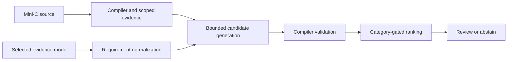

# Phase 2.5 architecture

Base revision `7b1c09927100518aaae9bb3444f99548f0bd1acd` includes PRs #1
and #2. The original classifier SHA-256 is
`2ba2d50afb8a5049ebffa489d8d3dbd1f747178e3b2ae45f1420ba72494fe03a`.
The Phase 2 ranker SHA-256 is
`2aff3d2d75f69e07dda46e519dedb384b2522ecafa2526a8f9b8b925439716cc`.

Keep the Phase 2 analysis function's default behavior for historical comparison.
The API opts into an expanded path. A scoped static evidence index links
declarations and prior uses and supports small expression, argument, index and
multi-edit alternatives. Compiler validation, deduplication, candidate bounds
and explicit approval continue to apply. The natural-language reader produces a
bounded operation or abstains. Clients choose how much requirement evidence to
supply.

Keep fitting, category selection/calibration and development checks on
separate program families. Freeze engine changes before scoring new final
cases. Report improvements from generation, ranking and requirement evidence
separately. Relative scores never control automatic application.

The engine and model were frozen at
`f1ff2ee4ae6594a83b8832ff38e7670df7d37812` before final input construction and
scoring. Omitting the optional API mode uses the compatible Phase 2 path.
The workbench selects a Phase 2.5 mode and retains the same approval and
source-snapshot protections.

The recovery module checks local def-use cues, nearby declarations or guards
with comparable operand and branch structure, repeated calls to the same
bound function, and literal indices against a declared extent. Diagnostic
repairs use typed environments and signature-compatible argument slots.
Two independent diagnostic edits can be composed under the same bounded
validation budget. Token-equivalent outcomes prefer the smaller edit.

The numerical model sees only comparable alternatives supported by compiler
diagnostics. Compiler validity, supplied requirements, and remaining
diagnostics dominate learned ordering. Code-only logical hypotheses stay in
deterministic review order. Artifact loading uses a fixed name and size cap.
A cooperative deadline is checked between compiler validations and ranking
groups. Missing ranker data or an exhausted ranking budget preserves
deterministic ordering of the candidates already validated.
