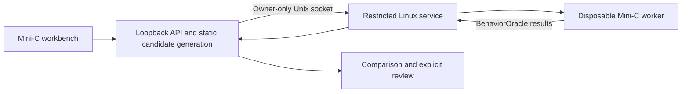

# Phase 4.5 architecture

The workbench queries a loopback FastAPI gateway for execution capability. On an admitted verification request, the gateway validates the source and vectors and, when requested, uses the existing intention engine to select compiler-valid alternatives in static rank order. It sends the original and up to four alternatives to the private Unix socket. The gateway verifies the service marker, program digests, entry point, candidate identities and observed input vectors before returning evidence.

Each admitted batch starts one new subprocess. It compiles and interprets Mini-C in the restricted child, using the existing BehaviorOracle and sharing its total step budget across the original, candidates and probes. The controller validates and caps worker output. Static Mini-C and Clang analysis and recorded behavioral demonstrations remain available when execution is disabled.

The [isolation guide](phase4_5_execution_isolation.md) reproduces the tested profile. The [API reference](phase4_5_interactive_api.md) describes admission and response fields.
