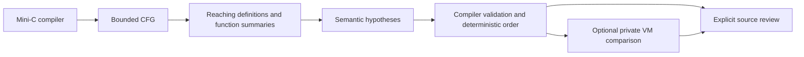

# Phase 6 architecture

IntentForge version 6 consumes the existing compiler's validated AST, expression types and lexical symbol table. It lowers each eligible function to statement-level basic blocks, computes conservative reaching definitions, slices return dependencies and builds a direct call graph. Proofs of local structure can produce review hypotheses. The existing compiler revalidates edits before they enter candidate review.

The intention endpoint accepts `engine_version: 6` with the existing modes and supports `include_context: true` for CFG detail. The behavioral endpoint uses the same opt-in number, then submits through the established private worker protocol. The browser keeps the exact source snapshot for manual approval.

[CFG](phase6_control_flow_graph.md) · [Dataflow](phase6_dataflow.md) · [Worker trust boundary](phase6_security.md)
