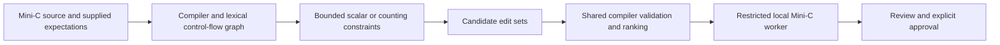

# Phase 8.5 architecture

Select engine `85` explicitly in Mini-C intention analysis or local behavioral
verification. It inherits Phase 8 typed requirements and admissibility checks.
The static engine adds a bounded scalar branch projection, a staged search for
two coordinated literals and a finite affine counting summary. The supported
shape selects the component for a given function. Ablations enable components
individually through the internal analysis API.

The intention API includes `program_analysis.phase85` when a specification can
be summarized. Local verification includes the same evidence as
`specification.phase85`. The public gateway maps engine 85 to existing private
profile 8. Candidate IDs, compiler validation, limits and the worker protocol use
the existing implementation.
